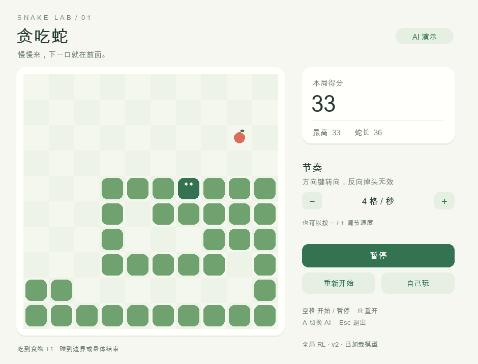
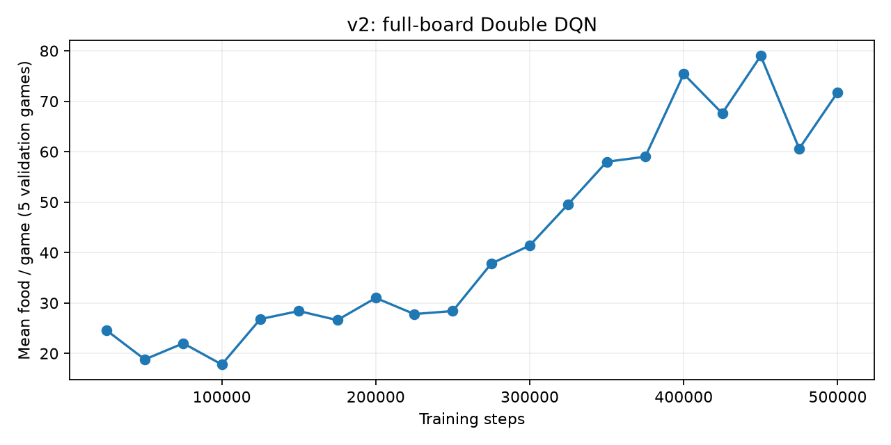

# Snake RL Lab · 贪吃蛇强化学习实验室

[](https://github.com/MochiaoChen/snake-rl-lab/actions/workflows/tests.yml)

在一台 **24GB MacBook Air** 上，从小型 DQN 开始，训练一个看完整棋盘的贪吃蛇 AI。中文桌面界面、可自己游玩、可切换 AI、保留每版代码和实测结果。



## 直接玩 / 看 AI

需要 [uv](https://docs.astral.sh/uv/getting-started/installation/)。主要测试平台是 Apple Silicon macOS，Python 3.12，CPU 训练。

```sh
git clone https://github.com/MochiaoChen/snake-rl-lab.git
cd snake-rl-lab
uv sync --python 3.12
uv run python play.py --ai
```

已包含训练好的 v1/v2 模型，无需先训练。macOS 也可双击 `玩贪吃蛇.command` 或 `看AI玩.command`。

- **方向键**：转向；禁止反向掉头。
- **空格**：开始 / 暂停；打开和重开时等待按键开始。
- **R**：重开，**A**：切换自己玩 / AI，**Esc**：退出。
- **− / +**：调节速度，每秒 1–20 格，默认 4 格；也支持右侧按钮。

速度只影响两步之间的等待时间，不改变模型输入、棋盘规则或奖励。

## v1 → v2：完整保留过程

10×10 棋盘，初始蛇长 3，填满棋盘需吃到 97 个食物。同一组 **50 个测试种子（300000–300049）**：

| 版本 | 观察与方法 | 平均食物数 | 单局最高 |
| --- | --- | ---: | ---: |
| v1 | 11 个局部特征，DQN | 19.56 | 32 |
| v1 + 碰撞检查 | 同一模型，只禁止立即碰撞 | 19.56 | 32 |
| **v2** | **完整棋盘，Double DQN，3 步回报** | **67.50** | **93** |

v2 测试中位数为 **78.50**；27 局碰撞、23 局超时，没有填满棋盘。平均每局 **5411.08 步**，部分长蛇局面会绕圈。v2 仍有改进空间，不保证通关。



曲线每个点是固定 **5 局验证**，用于选择检查点；表格来自另外 50 局测试。v2 使用 116483 个参数的全连接网络，50 万步训练及最终评估在这台电脑上约 **9 分 12 秒**。耗时随电脑和环境变化。

见 [实验过程](HISTORY.md)、[原始对比数据](versions/v2/run/comparison.json)、[v1 快照](versions/v1/) 和 [v2 快照](versions/v2/)。

```sh
uv run python play.py --ai --model versions/v1/run/best.zip
uv run python play.py --ai --model versions/v2/run/best.zip
```

## 模型看到了什么

三张完整棋盘：**蛇身位置及移动释放顺序、蛇头、食物**。补充朝向、时钟和各候选方向的连通空地、尾部可达性、食物距离。

模型使用即时碰撞动作掩码；只排除下一步会撞墙/撞身体的动作，未来的选路由神经网络完成。可达性和距离作为环境输入，没有固定路线或直接代替网络的路径规划器。改进同时涉及观察、训练算法、奖励和行动掩码；上表不能单独归因于其中一个因素。

计分仍是吃一个食物加 1。训练奖励为食物 +10、死亡 −10、每步 −0.01，并有微小的食物距离提示。跨版本请比较食物数量、步数与结局，累计 reward 不可直接比较。

## 重新训练

```sh
uv run python train_v2.py --steps 500000 --out runs/my-v2
uv run python play.py --ai --model runs/my-v2/best.zip
uv run python watch_progress.py --run runs/my-v2
```

每 25000 步评估并保存检查点；终端和 `progress.json` 显示进度、耗时、ETA。输出目录必须为空，避免覆盖旧实验。Ctrl+C 会保存已完成更新。双击 `开始训练.command` 自动建立带时间戳的实验目录。

`runs/` 为本地实验目录，不提交到 Git；稳定版代码、模型和结果放在 `versions/`。

## 后续实验：减少绕圈

`train_v3.py` 是单独的效率实验：从冻结的 v2 权重继续训练，增加移动成本，并只在训练阶段对连续 400 步不吃食物给出失败信号。观看和最终测试仍使用原规则；尚未验证提升时，默认模型继续使用 v2。

```sh
uv run python train_v3.py --steps 250000 --out runs/my-v3
```

## 检查

```sh
uv run pytest -q
uv run python play.py --ai --screenshot runs/preview.png --demo-steps 300
uv run python compare_versions.py --v2 versions/v2/run/best.zip --out runs/comparison.json
```

`uv.lock` 固定依赖。MIT 许可证；第三方实现来源见 [THIRD_PARTY_NOTICES.md](THIRD_PARTY_NOTICES.md)。
